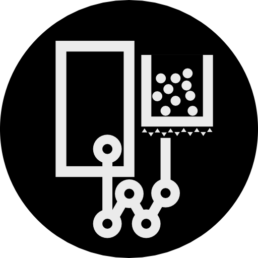
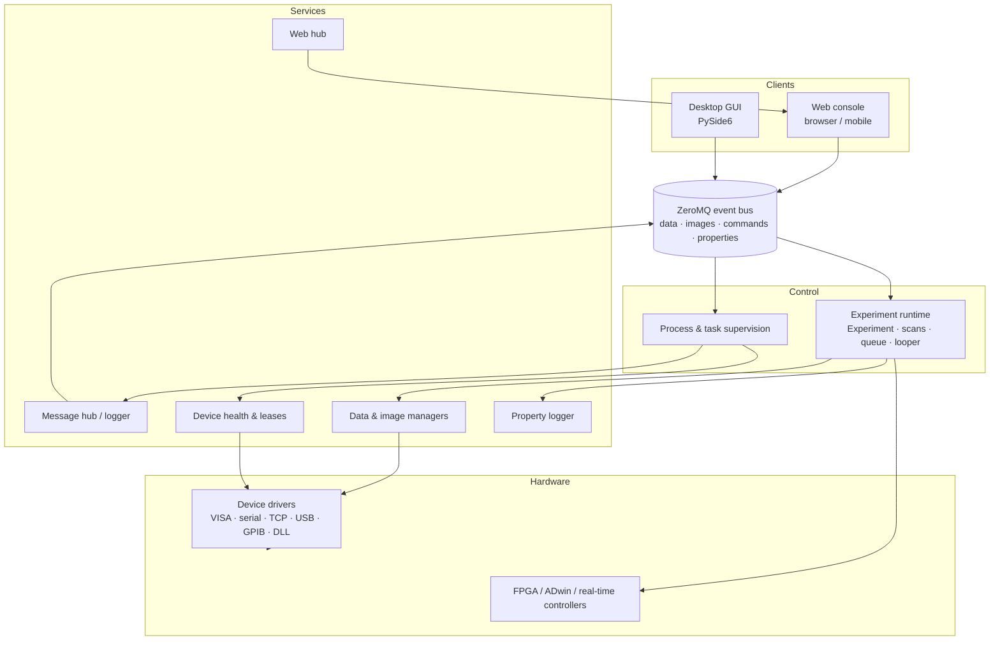

  
  <h1>Quatm</h1>
  
<strong>Control the experiment, not the software.</strong>

  
A Python-native, open-core control framework for cold atoms, ion traps, quantum optics and quantum chemistry.

  

    <a href="https://quatm.com"><strong>Website</strong></a> ·
    <a href="https://quatm.com/en/docs/"><strong>Documentation</strong></a> ·
    <a href="https://quatm.com/en/community/"><strong>Community</strong></a> ·
    <a href="mailto:contact@quatm.com"><strong>Contact</strong></a>
  

  

    
    
    
    
  

  English · <a href="https://github.com/quatm-team/.github/blob/main/profile/README.zh-CN.md">简体中文</a>

---

Quatm gives a quantum-physics laboratory one coherent model for instruments, timing, acquisition, analysis and remote operation. The experiment is written as a small Python class; the framework handles device state, sequencing, scans, data storage and the clients that observe them.

## What is in the stack

| Layer | Responsibility |
|---|---|
| **Experiment runtime** | `Experiment` classes with typed parameters, `build()` / `run()` lifecycle, deterministic timing, repetitions and scans |
| **Device layer** | One `device_db.py` model for VISA, serial, TCP, USB, GPIB and vendor DLLs; 100+ instrument drivers with per-driver hardware verification tracked in the repository |
| **Data pipeline** | ZeroMQ data and image streams, HDF5 acquisition, per-run metadata, live plots and image monitoring |
| **Analysis** | Absorption imaging, ion detection, Gaussian and skewed-Gaussian fits, ROI profiles and reusable analysis scripts |
| **Automation** | Experiment queue, preparation station, multi-dimensional scans, conditional loops and unattended operation |
| **Clients** | Desktop GUI (PySide6) and browser console, sharing queue, scan, property and live-data state |

## Design principles

- **The experiment is the source of truth.** Parameters, scan definitions and task state travel with the recorded data, so a run can be reconstructed without the original GUI session.
- **One model, many instruments.** Hardware is configured, not hard-coded. Mixed-vendor laboratories share parameters, calibration and logging.
- **Fail-isolated by construction.** Drivers, services, analysis and clients run as independent processes; a slow analysis job or remote browser cannot disturb real-time timing.
- **Automation without losing control.** Pause, resume, terminate and inspect each run. Long sequences can continue unattended while health checks and alarms remain active.

## Architecture

Every major component can run as an independent operating-system process. Clients and services communicate over local IPC or TCP, so a control PC, an analysis machine and a remote laptop can share one experiment without sharing one Python process.

## Start here

| If you want to… | Go to |
|---|---|
| Install Quatm and run a simulated experiment | [Getting started](https://quatm.com/en/docs/getting-started/) |
| Integrate an instrument | [Device drivers](https://quatm.com/en/docs/device-drivers/) |
| Write an experiment | [Experiment editing](https://quatm.com/en/docs/experiment-editing/) |
| Run a complete example | [Experiment examples](https://quatm.com/en/docs/examples/) |
| Understand the deployment model | [Deployment](https://quatm.com/en/docs/deployment/) |

## Open-core licensing

Quatm is not distributed under a single licence.

- `quatm/experiment`, `quatm/physics`, `quatm/servers` and `quatm/utils` are released under **GNU AGPL v3**.
- `quatm/GUI`, `quatm/web` and `quatm/licensing` are **commercial/proprietary**.
- `quatm/analysis`, `quatm/monitor` and `quatm/drivers` are proprietary and are not included in the pip distribution.

The AGPL core may be used for research, teaching and compliant commercial work. A commercial licence is required when AGPL source-sharing obligations cannot be met, for example for proprietary redistribution. See [Licensing and commercial use](https://quatm.com/en/licensing/) for details.

## Community and support

- **Documentation:** [quatm.com/en/docs](https://quatm.com/en/docs/)
- **Questions and collaboration:** [contact@quatm.com](mailto:contact@quatm.com)
- **Commercial licensing:** [sales@quatm.com](mailto:sales@quatm.com)
- **Security reports:** [security@quatm.com](mailto:security@quatm.com) — please do not open a public issue for vulnerabilities.
- **Contributing:** [CONTRIBUTING.md](https://github.com/quatm-team/.github/blob/main/CONTRIBUTING.md)
- **Support:** [SUPPORT.md](https://github.com/quatm-team/.github/blob/main/SUPPORT.md)

> Quatm is in active development and is used in research laboratories. Interfaces may evolve between releases; incompatible changes are documented in the changelog and migration notes.
