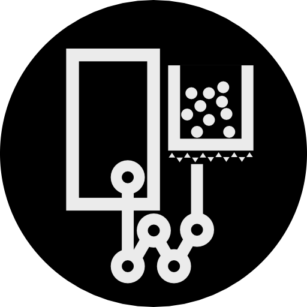
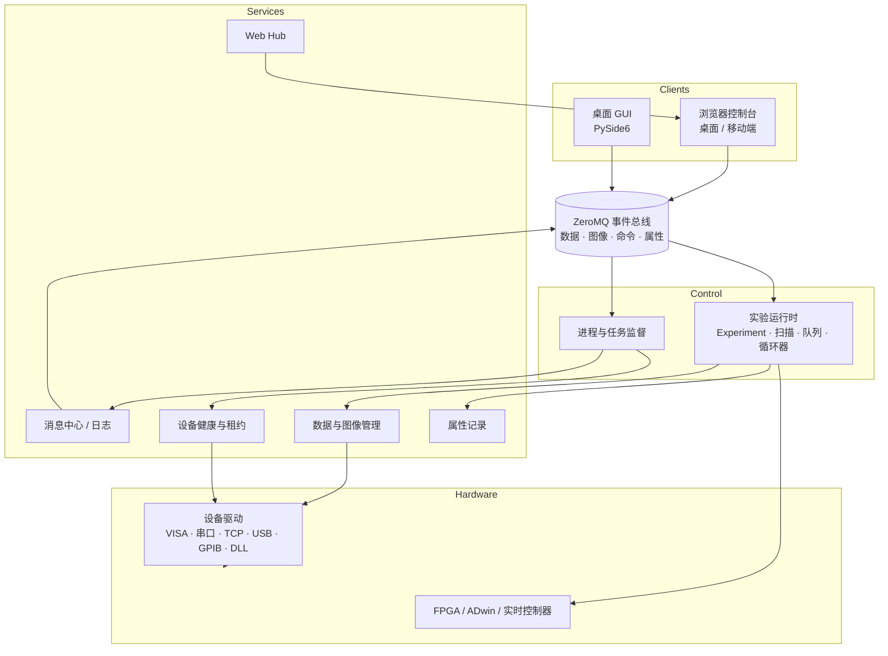

  
  <h1>Quatm</h1>
  
<strong>掌控实验，而不是被软件掌控。</strong>

  
面向冷原子、离子阱、量子光学与量子化学实验的 Python 原生、开放核心（open-core）控制框架。

  

    <a href="https://quatm.com/"><strong>官方网站</strong></a> ·
    <a href="https://quatm.com/开发文档/"><strong>开发文档</strong></a> ·
    <a href="https://quatm.com/技术交流/"><strong>技术交流</strong></a> ·
    <a href="mailto:contact@quatm.com"><strong>联系我们</strong></a>
  

  

    
    
    
    
  

  <a href="https://github.com/quatm-team/.github/blob/main/profile/README.md">English</a> · 简体中文

---

Quatm 为量子物理实验室提供一套统一的模型，用来描述仪器、时序、数据采集、分析与远程操作。实验被写成一个小型 Python 类；框架负责设备状态、序列执行、扫描、数据存储，以及观察这些过程的桌面与浏览器客户端。

## 技术栈

| 层次 | 职责 |
|---|---|
| **实验运行时** | `Experiment` 类、类型化参数、`build()` / `run()` 生命周期、确定性时序、重复与扫描 |
| **设备层** | 用一份 `device_db.py` 统一描述 VISA、串口、TCP、USB、GPIB 与厂商 DLL 设备；100+ 驱动，并在仓库中逐一跟踪硬件验证状态 |
| **数据管线** | ZeroMQ 数据/图像流、HDF5 采集、逐次运行元数据、实时曲线与图像监控 |
| **分析** | 吸收成像、离子探测、高斯/偏高斯拟合、ROI 剖面与可复用分析脚本 |
| **自动化** | 实验队列、任务暂存器、多维扫描、条件循环与无人值守运行 |
| **客户端** | PySide6 桌面 GUI 与浏览器控制台，共享队列、扫描、属性与实时数据状态 |

## 设计原则

- **实验本身是唯一事实来源。** 参数、扫描定义与任务状态随数据一起保存，离开原 GUI 会话也能重建一次运行。
- **一套模型，多种仪器。** 硬件通过配置接入，而不是写死在代码里；混合厂商实验室共享参数、校准与日志模型。
- **故障隔离。** 驱动、服务、分析与客户端运行在独立进程中；慢分析或远程浏览器不会干扰实时时序。
- **自动化但不失控。** 每次运行都可暂停、恢复、终止和检查；长序列可无人值守运行，同时健康检查与告警保持在线。

## 架构

每个主要组件都可以作为独立操作系统进程运行。客户端与服务通过本机 IPC 或 TCP 通信，因此控制机、分析机与远程笔记本可以共享同一套实验状态，而不必共享同一个 Python 进程。

## 从这里开始

| 你想做什么 | 入口 |
|---|---|
| 安装 Quatm 并运行模拟实验 | [快速开始](https://quatm.com/开发文档/快速开始/) |
| 接入一台仪器 | [设备驱动](https://quatm.com/开发文档/设备驱动/) |
| 编写实验 | [实验编辑](https://quatm.com/开发文档/实验编辑/) |
| 运行完整示例 | [实验示例](https://quatm.com/开发文档/实验示例/) |
| 了解部署方式 | [部署](https://quatm.com/开发文档/部署指南/) |

## Open-core 许可

Quatm 不是单一许可证发布：

- `quatm/experiment`、`quatm/physics`、`quatm/servers`、`quatm/utils` 以 **GNU AGPL v3** 发布。
- `quatm/GUI`、`quatm/web`、`quatm/licensing` 为**商业/专有**组件。
- `quatm/analysis`、`quatm/monitor`、`quatm/drivers` 为专有组件，不包含在 pip 发行包中。

AGPL 核心可用于学术研究、教学与符合义务的商业场景；无法履行 AGPL 源码共享义务时（例如闭源再分发），需要商业许可证。详见[许可证与商业使用](https://quatm.com/许可证/)。

## 社区与支持

- **开发文档：** [quatm.com/开发文档](https://quatm.com/开发文档/)
- **问题与合作：** [contact@quatm.com](mailto:contact@quatm.com)
- **商业授权：** [sales@quatm.com](mailto:sales@quatm.com)
- **安全报告：** [security@quatm.com](mailto:security@quatm.com)，请勿为安全漏洞开公开 Issue。
- **贡献指南：** [CONTRIBUTING.md](https://github.com/quatm-team/.github/blob/main/CONTRIBUTING.md)
- **支持渠道：** [SUPPORT.md](https://github.com/quatm-team/.github/blob/main/SUPPORT.md)

> Quatm 正在持续开发，并已在多个研究实验室使用。接口可能随版本演进；不兼容变更会记录在更新日志与迁移说明中。
